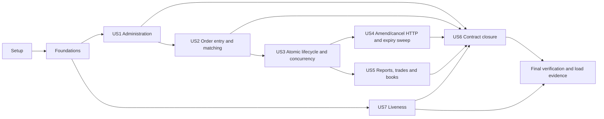

# Tasks: Electronic Financial Exchange Simulator

**Created**: 2026-11-10  
**Feature directory**: `specs/001-exchange-simulator`  
**Input**: [plan.md](plan.md), [spec.md](spec.md), [research.md](research.md), [data-model.md](data-model.md), [API companion](contracts/api.md), [OpenAPI](contracts/openapi.json), [quickstart.md](quickstart.md), [requirements traceability](requirements-traceability.md), and [constitution v2.0.0](../../.specify/memory/constitution.md).

**Prerequisites**: The specification and design are the approved implementation inputs. This document schedules work; it does not implement the service or claim any tests passed. Existing user stories, acceptance scenarios, requirement IDs and API behavior remain unchanged.

**Tests**: Included because the specification explicitly requires automated acceptance, concurrency, storage-contract and numeric performance evidence (FR-032.1–FR-032.10, FR-034.4–FR-034.8, FR-037.1–FR-037.14; SC-001–SC-012). Story test tasks precede their implementation; confirm they detect missing/incorrect behavior before making them pass. Test helpers can be added first; compile failures alone are not evidence of behavioral coverage.

**Organization**: Setup → shared foundations → US1/US2/US3 (P1) → US4/US5/US6 (P2) → US7 (P3) → cross-cutting release validation. Every story is a testable increment using preconfigured fixtures for other journeys. The first demo scope is administration (US1); the trading demo adds US2 and US3. All relevant release gates still apply to delivered behavior.

## Format: `[ID] [P?] [Story] Description`

- Every task has an unchecked checkbox, unique sequential ID and exact repository-relative file paths.
- `[P]` identifies work that can run beside a different ready task on different files. It never removes prerequisites; the execution waves below state when it is safe.
- Story phases use `[US1]`–`[US7]`; setup, foundations and polish have no story label.
- Atomic child IDs (for example `FR-018.8`) are the verification units. Inclusive ranges enumerate all children in that range; the final coverage table resolves all 385 children to planned work.
- Shared fixtures may execute several checks together, but assertions/results retain separate atomic-child pass/fail identity. The two MAY permissions remain optional design choices, not new mandatory behavior.

## Path Conventions

One Maven service at repository root. Main Java sources use `src/main/java/com/finex/exchange/`; tests use `src/test/java/com/finex/exchange/`; runtime configuration is `src/main/resources/application.yaml`. Exact files are named on each task. No UI, database, persistent adapter, real assets or additional deployable is included.

Field constraints quoted on model/value tasks are copied from [data-model.md](data-model.md); the API companion and OpenAPI retain their additional wire limits. Implement the specified numbers and enum/omission rules rather than choosing new defaults.

## Phase 1: Setup (Shared Infrastructure)

**Goal**: Create the single Maven/JDK 21 service and verification entry points from the approved plan.

**Independent test**: The wrapper reports JDK 21; the application packages as an executable JAR and the verification lifecycle discovers unit and integration tests.

### Implementation and validation

- [ ] T001 Pin Spring Boot parent/plugin 4.1.0, Java compiler release 21 and artifact exchange-simulator:0.1.0-SNAPSHOT; add the planned MVC, Validation, Security, Actuator, MVC-test and security-test dependencies through Boot dependency management; configure Surefire, Failsafe (*IT) and an opt-in performance profile that ordinary verify excludes. Files: `pom.xml`.
- [ ] T002 Generate Maven Wrapper 3.9.11 with distribution checksum and both launcher scripts; require/select JDK 21 before build execution. Files: `mvnw`, `mvnw.cmd`, `.mvn/wrapper/maven-wrapper.properties`.
- [ ] T003 Create the application entry point and inward package boundaries (domain JDK-only, application ports/services, HTTP and memory adapters, configuration); ensure the executable JAR has the planned name. Files: `src/main/java/com/finex/exchange/ExchangeApplication.java`.
- [ ] T004 [P] Declare validated runtime settings and the API companion defaults: 16 KiB body/headers, 8 KiB URI, 2 s request/read timeout, 128 business permits, 160 connector workers/backlog 256, 250 ms total lock/duplicate deadline, 200 requests/s per principal with burst 400, loopback management :8081 and no public management aliases. Files: `src/main/resources/application.yaml`, `src/main/java/com/finex/exchange/configuration/ExchangeProperties.java`. Requirements: FR-036.1–FR-036.5.
- [ ] T005 [P] Create reusable seeded fixture builders, injectable mutable UTC Clock and barrier/fault-test support; keep all credentials synthetic and generated at runtime; add separate source/test package-boundary checks without binding behavioral fixtures to memory collection types. Files: `src/test/java/com/finex/exchange/support/ExchangeFixtures.java`, `src/test/java/com/finex/exchange/support/MutableClock.java`, `src/test/java/com/finex/exchange/support/ConcurrencyHarness.java`, `src/test/java/com/finex/exchange/contract/ArchitectureTest.java`. Requirements: FR-034.4–FR-034.8.

**Checkpoint**: The build is reproducible; no exchange behavior is claimed by this checkpoint.

---

## Phase 2: Foundational (Blocking Prerequisites)

**Goal**: Provide shared HTTP, identity, transaction, capacity and query infrastructure before exposing business operations.

**Independent test**: Foundation contract tests demonstrate safe envelope errors, lock ordering, rollback, bounded admission and port isolation with controlled test deltas.

### Implementation and validation

- [ ] T006 Implement generated UUID entity/identity values, Clock wiring and checked counters: "Generated opaque entity IDs; command key 1–128 printable ASCII characters."; "Version starts 1. Numeric JSON integer where exposed; counter exhaustion rejects before changes." Never use timestamps alone for acceptance ordering. Files: `src/main/java/com/finex/exchange/domain/EntityId.java`, `src/main/java/com/finex/exchange/domain/CheckedSequence.java`, `src/main/java/com/finex/exchange/configuration/TimeConfiguration.java`. Requirements: FR-009.9–FR-009.14, FR-032.5–FR-032.9, FR-033.4.
- [ ] T007 [P] Implement exact decimal/quantity values from validated text: "Whole shares; order total 1–1,000,000,000; JSON integer. Aggregates use checked `long`, never wrap."; "Plain decimal string, 1–24 characters, at most 6 fractional digits; value >0 and ≤1,000,000,000. Rounding to a tick must remain positive and within range." Use digits/optional dot grammar without signs, grouping or exponent, nearest-tick HALF_UP (including 0.05), canonical plain output and exact midpoint with up to 7 fractional digits. Files: `src/main/java/com/finex/exchange/domain/DecimalValue.java`, `src/main/java/com/finex/exchange/domain/Quantity.java`. Requirements: FR-011.1–FR-011.20, FR-027.5–FR-027.6.
- [ ] T008 Define application-owned ExchangeTransactionPort, ExchangeQueryPort and IdentityPort using immutable command/result views and complete operation boundaries, with a reusable adapter fixture factory; specify atomicity, conflicts, ordering, deadlines, idempotency, copy-on-read and storage-error behavior, with no mutable map/queue or vendor types escaping. Files: `src/main/java/com/finex/exchange/application/port/ExchangeTransactionPort.java`, `src/main/java/com/finex/exchange/application/port/ExchangeQueryPort.java`, `src/main/java/com/finex/exchange/application/port/IdentityPort.java`, `src/test/java/com/finex/exchange/contract/ExchangeAdapterFixture.java`. Requirements: FR-031.1–FR-031.5, FR-032.1–FR-032.10, FR-033.1–FR-033.4, FR-034.4–FR-034.8.
- [ ] T009 [P] Define immutable application outcomes plus the complete spec numeric/reason catalog and operation/precedence selector; distinguish handled rejection HTTP 200/success=false from technical 4xx/5xx, retain successful create 201, code 0 status/trades, and filled-cancel failure 1018 versus filled-report 1015. No framework HTTP exceptions in the domain. Files: `src/main/java/com/finex/exchange/application/OperationOutcome.java`, `src/main/java/com/finex/exchange/application/ResultCode.java`, `src/main/java/com/finex/exchange/application/FailureReason.java`. Requirements: FR-029.1–FR-029.6, FR-043.1–FR-043.5.
- [ ] T010 Implement the one JSON envelope/response writer, fresh generated X-Correlation-ID, application/json and Cache-Control:no-store for success and failure; unused messages are empty strings, data.reasonCode is mandatory on failure, and data contains no partial/private result. Format Instants with "`dd-MMM-yyyy HH:mm:ss.SSS`, English months, UTC; never used alone to break priority ties." Files: `src/main/java/com/finex/exchange/adapter/http/ApiEnvelope.java`, `src/main/java/com/finex/exchange/adapter/http/ApiResponseWriter.java`, `src/main/java/com/finex/exchange/adapter/http/CorrelationFilter.java`. Requirements: FR-040.1–FR-040.9, FR-042.1–FR-042.6, FR-044.1–FR-044.5.
- [ ] T011 Configure Jackson 3 and request DTO decoding to preserve absent versus malformed business fields without number-to-string/float-to-integer coercion; parseable invalid fields go to entity-specific HTTP 200 rejection, malformed JSON to 400, wrong body media to 415; reject unknown fields through the documented business validation profile. GET requires no body, Content-Type or Accept. Files: `src/main/java/com/finex/exchange/configuration/JsonConfiguration.java`, `src/main/java/com/finex/exchange/adapter/http/BusinessRequestDecoder.java`. Requirements: FR-011.8–FR-011.20, FR-029.6, FR-039.1–FR-039.5.
- [ ] T012 [P] Define the identity records and bootstrap: "`PrincipalId`: immutable generated identity; `role`: ADMINISTRATOR or PARTICIPANT."; "`username`: 1–64 ASCII letters/digits/dot/underscore/hyphen; unique, case-sensitive."; "`brokerId`: required for PARTICIPANT, absent for ADMINISTRATOR; server-owned mapping." Require valid FINEX_ADMIN_USERNAME/PASSWORD, fail startup without them, BCrypt cost 10, and honor "16–64 ASCII characters" write-only password input; hash outside metadata/commit locks. Files: `src/main/java/com/finex/exchange/domain/Identity.java`, `src/main/java/com/finex/exchange/adapter/memory/InMemoryIdentityStore.java`, `src/main/java/com/finex/exchange/configuration/AdminBootstrap.java`. Requirements: FR-002.1–FR-002.4, FR-003.1–FR-003.7.
- [ ] T013 Implement successful-auth cache keyed by process-random HMAC of the bounded Authorization value: maximum 10,000 entries, jittered 45–60 s TTL, four miss-verification permits, coalesced same-credential misses, no failed credential cache or raw header/password retention. Recheck active/credentialGeneration every request and inside protected commands, private-copy queries and replay; revoke immediately on rotation/delete. Preserve the model constraint "`credentialGeneration`, `active`: revoke/delete/rotation boundaries checked on every request." Files: `src/main/java/com/finex/exchange/adapter/http/BasicAuthenticationProvider.java`, `src/main/java/com/finex/exchange/adapter/http/SuccessfulAuthenticationCache.java`. Requirements: FR-002.1, FR-003.1, FR-008.9, FR-030.7–FR-030.8.
- [ ] T014 Wire stateless Basic chains: /internal/** administrator first, exact GET /status public, explicit root participant resources active-Broker only, unmatched denied; no implicit Admin trading privilege, sessions/form login or browser cross-origin use. Shared JSON entry/denial handlers retain WWW-Authenticate on 401; require TLS outside documented loopback mode and operator-only management. Files: `src/main/java/com/finex/exchange/configuration/SecurityConfiguration.java`, `src/main/java/com/finex/exchange/adapter/http/SecurityErrorHandlers.java`. Requirements: FR-001.1–FR-001.2, FR-002.1–FR-002.4, FR-004.5–FR-004.6, FR-038.8–FR-038.9.
- [ ] T015 Implement fair metadata read/write gate and stable per-product slots/locks with sorted multi-product acquisition under one 250 ms deadline; enforce admission → command reservation → metadata gate → sorted product locks, forbid read/write upgrade, release in reverse order, and never await duplicates or hash/serialize/run callbacks under business locks. Files: `src/main/java/com/finex/exchange/adapter/memory/MetadataGate.java`, `src/main/java/com/finex/exchange/adapter/memory/ProductSlot.java`, `src/main/java/com/finex/exchange/adapter/memory/LockCoordinator.java`. Requirements: FR-032.1–FR-032.4, FR-033.1–FR-033.3.
- [ ] T016 Implement immutable audit creation and segmented memory retention with "One logical mutation has one audit event"; include actor/command/accepted ordering/time/affected IDs/outcome and related trades, no password/hash/full HTTP payload. Commit with business state/outcome, retain process lifetime, and create no extra mutation audit on replay. Files: `src/main/java/com/finex/exchange/domain/AuditEvent.java`, `src/main/java/com/finex/exchange/adapter/memory/InMemoryAuditLog.java`. Requirements: FR-035.1–FR-035.7, FR-035.14.
- [ ] T017 Implement immutable staged deltas and a preallocated touched-entry undo journal covering nodes, maps, counters, history, audit and completed outcomes; publish outcome last and notify waiters after unlocking. Roll back before release on recoverable faults; compensate only own shared counter deltas and remove only own shared history entries. Add injectable fail points between every apply write, with no whole-history copies. Files: `src/main/java/com/finex/exchange/adapter/memory/CommitJournal.java`, `src/main/java/com/finex/exchange/adapter/memory/AtomicCommitter.java`, `src/main/java/com/finex/exchange/adapter/memory/CommitFaultInjector.java`. Requirements: FR-031.1, FR-032.1, FR-035.1–FR-035.7, FR-035.14.
- [ ] T018 Implement count and weighted-byte reservation ledger: caps products 1,000/Brokers 10,000/orders 1,000,000/trades 2,000,000/audit 2,000,000/completed keys 1,000,000, 10,000 open orders/product, 1,536 MiB soft state budget and 2,000 prospective matches/command. Reserve cancellation/expiry lifecycle capacity before accepting exposure; whole-command rejection before effects, no promised-history eviction and no truncated matching. Files: `src/main/java/com/finex/exchange/adapter/memory/CapacityLedger.java`, `src/main/java/com/finex/exchange/adapter/memory/LifecycleReservation.java`. Requirements: FR-036.6–FR-036.10, FR-037.8–FR-037.14.
- [ ] T019 Implement global (principalId,key) IN_FLIGHT/COMPLETED command reservations, immutable status/body outcomes and completion time; preserve model constraints "IN_FLIGHT/COMPLETED reservation" and "expiry at least 24h later"; retain completed records at least 24 h while alive, never expire in-flight, bound duplicate waiting to 250 ms/503 COMMAND_IN_PROGRESS, and release retryable pre-commit failures. Commit business rejections for replay and keep callers isolated across products and operation targets. Files: `src/main/java/com/finex/exchange/adapter/memory/CommandRegistry.java`, `src/main/java/com/finex/exchange/domain/CommandOutcome.java`. Requirements: FR-030.1–FR-030.8, FR-031.1–FR-031.5, FR-043.3–FR-043.5.
- [ ] T020 Canonicalize operation, target and parsed payload fingerprints before domain locking: exact decimals before tick rounding, omission equals documented default, changed expectedVersion changes identity, password fields use keyed digest. Validate printable-ASCII idempotency keys and operation-specific rejection codes; never retain plaintext secrets in outcomes/fingerprints. Files: `src/main/java/com/finex/exchange/application/CommandFingerprint.java`, `src/main/java/com/finex/exchange/adapter/http/IdempotencyKeyReader.java`. Requirements: FR-030.1–FR-030.6, FR-031.5.
- [ ] T021 [P] Implement opaque signed caller/filter-bound seek cursors with initial high-water mark, per-process secret, 5 minute expiry and bounded 2,048-character wire token; invalid/expired/restarted cursors fail 400 MALFORMED_REQUEST. Share default page size 100/max 500 validation with explicit 200 REQUEST_LIMIT_EXCEEDED; book revisions use separate stale-cursor business rejection. Files: `src/main/java/com/finex/exchange/application/PageRequest.java`, `src/main/java/com/finex/exchange/adapter/http/CursorCodec.java`. Requirements: FR-036.3, FR-036.6–FR-036.9.
- [ ] T022 Implement bounded request/header/URI enforcement, total business admission, unauthenticated verification admission, per-principal throttling and consistent MVC/security/container error fallbacks for documented 400/401/403/404/405/413/415/429/431/500/503 outcomes. Keep semantic rejections at 200, Retry-After:1 for retryable overload and exact unexpected message "An unexpected error occurred." with correlated internal diagnostics. Files: `src/main/java/com/finex/exchange/adapter/http/AdmissionFilter.java`, `src/main/java/com/finex/exchange/adapter/http/RequestLimitsFilter.java`, `src/main/java/com/finex/exchange/adapter/http/ApiExceptionHandler.java`, `src/main/java/com/finex/exchange/configuration/ContainerErrorConfiguration.java`. Requirements: FR-029.1–FR-029.6, FR-036.1–FR-036.10, FR-041.1–FR-041.10.
- [ ] T023 Add focused tests for exact values/non-power-of-ten rounding and overflow, HTTP business-versus-parser errors, fail-closed bootstrap, port isolation, sorted lock deadlines, rollback of controlled deltas under cross-product commits, capacity-reserve accounting and caller-bound cursor tampering/expiry. Files: `src/test/java/com/finex/exchange/domain/ExactValuesTest.java`, `src/test/java/com/finex/exchange/contract/FoundationContractTest.java`, `src/test/java/com/finex/exchange/http/FoundationHttpTest.java`, `src/test/java/com/finex/exchange/concurrency/CommitJournalTest.java`. Requirements: FR-011.1–FR-011.20, FR-029.1–FR-029.6, FR-031.1, FR-032.1, FR-036.6–FR-036.10, FR-041.1–FR-041.10.

**Checkpoint**: All foundation tasks must pass before any story phase starts. Shared infrastructure already protects the first trading slice.

---

## Phase 3: User Story 1 — Administer the Trading Universe (P1, first demo)

**Goal**: Deliver protected product and Broker lifecycles and the root read-only product catalog.

**Independent test**: An Admin creates/finds/updates/deletes Equity and Broker data without trading; participant internal calls fail, normalized duplicates fail, IDs remain stable, and seeded booked orders block deletion.

### Tests

- [ ] T024 [P] [US1] Write schema/HTTP contracts for every internal product/Broker operation and root product reads: 201 creation, 200 business misses/rejections, codes 1001–1012 and 9000, bodyless GET, exact credentials exclusion and JSON deletion. Include every US1 acceptance scenario using port-seeded open exposure where needed. Files: `src/test/java/com/finex/exchange/contract/AdministrationApiContractTest.java`. Requirements: FR-005.1–FR-005.14, FR-006.1–FR-006.9, FR-007.1–FR-007.13, FR-038.3–FR-038.4, FR-039.1–FR-039.5, FR-044.2–FR-044.5.
- [ ] T025 [P] [US1] Write role/bootstrap and reference-data race tests: participants denied all internal methods, Admin not a Broker, duplicate concurrent normalized symbols/usernames, deleting unused versus seeded in-use entities, rotation/delete revocation including cached authentication and protected-boundary recheck. Files: `src/test/java/com/finex/exchange/integration/AdministrationSecurityIT.java`, `src/test/java/com/finex/exchange/concurrency/ReferenceDataRaceTest.java`. Requirements: FR-002.1–FR-002.4, FR-008.1–FR-008.13.
### Implementation and validation

- [ ] T026 [P] [US1] Create immutable Equity product and normalized symbol values with "`description` (1–512 characters)" and "`tickSize` (default `0.01`)"; symbol rule: "Trim/uppercase with `Locale.ROOT`; 1–32 ASCII letters/digits, dot or hyphen, begins alphanumeric. Unique including retained tombstones." ID/type immutable, active state/revision explicit; raw symbol max 96, reject blank attributes. Files: `src/main/java/com/finex/exchange/domain/Product.java`, `src/main/java/com/finex/exchange/domain/ProductSymbol.java`. Requirements: FR-005.7–FR-005.14, FR-006.1–FR-006.9.
- [ ] T027 [P] [US1] Create Broker model with "`name` (trimmed, 1–128 characters)" and "`type=BROKER`"; generated immutable id/principalId, active flag and transactional openOrderCount; names need not be unique. Preserve "Open count counts orders with positive booked quantity, not shares, and changes together with the matching/cancel/expiry transaction." Keep username, principal ID, Broker ID and type immutable; never return password/hash. Files: `src/main/java/com/finex/exchange/domain/Broker.java`. Requirements: FR-007.6–FR-007.13, FR-003.1.
- [ ] T028 [US1] Implement reference-data ID/symbol/username indexes, retained tombstones, catalog registration sequences and stable ProductSlot registration; create Broker+credentials atomically, update/revoke generations atomically, and preserve history plus reserved symbols after delete. Use the foundation journal/outcome protocol under exclusive metadata gate. Files: `src/main/java/com/finex/exchange/adapter/memory/InMemoryReferenceDataStore.java`. Requirements: FR-005.1–FR-005.14, FR-007.1–FR-007.13, FR-008.3–FR-008.9.
- [ ] T029 [US1] Implement in-use guards for product delete/symbol/tick edits and Broker delete under metadata write gate plus sorted affected product locks; run the expiry participant before checking booked/open-order counts. Choose permitted in-use description/name updates without reprioritizing orders; expose the adapter hook for real expiry wiring in US3. Files: `src/main/java/com/finex/exchange/adapter/memory/ReferenceDataMutationCoordinator.java`. Requirements: FR-006.9, FR-008.1–FR-008.13.
- [ ] T030 [US1] Implement product lifecycle/query orchestration, explicit type validation, normalized ID/symbol lookup, signed bounded catalog continuation and entity-specific outcomes, using only application ports and server-side role checks. Files: `src/main/java/com/finex/exchange/application/service/ProductService.java`. Requirements: FR-004.3, FR-005.1–FR-005.14, FR-006.1–FR-006.9.
- [ ] T031 [US1] Implement Broker create/read/list/name or password update/delete through identity/transaction ports; require name, explicit type, username and password on create, reject unsupported/missing types and duplicate username, prepare BCrypt outside locks and return safe views only. Files: `src/main/java/com/finex/exchange/application/service/BrokerService.java`. Requirements: FR-004.5–FR-004.6, FR-007.1–FR-007.13, FR-008.9.
- [ ] T032 [US1] Add internal product/Broker controllers and validated DTO mappings, and the root product GET/list routes; no root product writes or root Broker-management aliases. Wire mandatory command keys on all writes including DELETE and shared bodyless read behavior. Files: `src/main/java/com/finex/exchange/adapter/http/InternalProductController.java`, `src/main/java/com/finex/exchange/adapter/http/InternalBrokerController.java`, `src/main/java/com/finex/exchange/adapter/http/ProductCatalogController.java`, `src/main/java/com/finex/exchange/adapter/http/ReferenceDataDtos.java`. Requirements: FR-001.1, FR-004.3, FR-004.5–FR-004.6, FR-038.3–FR-038.4, FR-038.8–FR-038.9, FR-039.1–FR-039.5.
- [ ] T033 [US1] Run the complete admin lifecycle and security contracts on the real memory adapter/random-port HTTP server; verify concurrent normalized uniqueness, missing/unsupported types, deletion rollback, no secret leakage, mutation audit/outcome replay and missing-entity codes. Record child-level outcomes in the verification fixture. Files: `src/test/java/com/finex/exchange/integration/AdministrationLifecycleIT.java`. Requirements: FR-005.1–FR-005.14, FR-006.1–FR-006.9, FR-007.1–FR-007.13, FR-008.1–FR-008.13.

**Checkpoint**: US1.1–US1.7 pass; this administration demo is the first MVP increment, not a trading-capacity release.

---

## Phase 4: User Story 2 — Submit and Match Orders Fairly (P1)

**Goal**: Deliver accepted/rejected order submission, exact price-time matching and the immediate report.

**Independent test**: With seeded products/Brokers, run US2.1–US2.8 plus exact tick/quantity edge cases and compare all fills and remainders against an independent reference matcher.

### Tests

- [ ] T034 [P] [US2] Write deterministic pure-matcher tests for US2 examples, equal displayed timestamps, self-match allowed, multiple products, crossing/noncrossing limits, market exhaustion, exact 0.01/0.05 HALF_UP and rejected-entry absence; compare at least 10,000 seeded submission sequences to an independent reference algorithm. Files: `src/test/java/com/finex/exchange/domain/MatchingEngineTest.java`, `src/test/java/com/finex/exchange/support/ReferenceExchange.java`, `src/test/java/com/finex/exchange/domain/MatchingReferenceModelTest.java`. Requirements: FR-010.1–FR-010.17, FR-011.1–FR-011.20, FR-014.1–FR-014.6, FR-015.1–FR-015.3, FR-016.1–FR-016.5, FR-017.1–FR-017.6.
- [ ] T035 [P] [US2] Write POST /order contracts for every validation reason, participant binding/spoofing, idempotent submission, string decimals versus JSON numeric prices, DAY default, MARKET price omission/warnings, immediate fill 1018 versus accepted 1013 and version-1 initial fills. Files: `src/test/java/com/finex/exchange/contract/OrderEntryApiContractTest.java`. Requirements: FR-003.1–FR-003.7, FR-009.1–FR-009.14, FR-010.1–FR-010.17, FR-012.1–FR-012.4, FR-032.5, FR-043.1–FR-043.2.
### Implementation and validation

- [ ] T036 [US2] Define immutable Order with "BUY/SELL, LIMIT/MARKET, DAY; immutable."; identity/reference rule "Immutable order identity and references."; price rule "Current normalized limit price; omitted on market orders."; original-total rule "Original submitted whole-share total; immutable even after amendment."; priority rule "Current product-local queue priority; price change/increase resets it."; version rule "Current optimistic amendment version; positive integer."; reason rule "Status below; reason absent unless removed quantity is positive."; trade-reference rule "Execution-order references; response pages use the bounded continuation policy."; identity/product/participant and "Original successful acceptance time and UTC trading day; immutable."; normalized limit price omitted for MARKET, original/effective/traded/booked/removed quantities, checked positive version/priority and execution-order trade references. Enforce "`traded + booked + removed = effectiveTotal`; every value is nonnegative" and never store REJECTED. Files: `src/main/java/com/finex/exchange/domain/Order.java`, `src/main/java/com/finex/exchange/domain/OrderStatus.java`, `src/main/java/com/finex/exchange/domain/RemovalReason.java`. Requirements: FR-009.1–FR-009.14, FR-012.1–FR-012.4, FR-023.20, FR-024.1–FR-024.2.
- [ ] T037 [US2] Define immutable Trade with model constraint "Immutable `id`, `time`, `buyOrderId`, `sellOrderId`, `productId`, price, positive quantity, and internal product sequence and process-wide insertion sequence." Use generated ID, Instant, product/buy/sell order IDs, exact resting price, "positive quantity", product sequence and process-wide insertion sequence. Stage IDs before publication, allocate insertion sequence only while holding product lock, never decrement/reuse on rollback and permit harmless failed-command gaps. Files: `src/main/java/com/finex/exchange/domain/Trade.java`. Requirements: FR-016.1–FR-016.5, FR-025.3–FR-025.11.
- [ ] T038 [US2] Implement pure ordered book/price-level operations: numeric descending bids, ascending offers, insertion-ordered same-price nodes, order-ID node index, exact checked totals, empty-level removal and revision on open-content changes. Lazily allocate books under stable product slots; empty active products have an empty view. Files: `src/main/java/com/finex/exchange/domain/OrderBook.java`, `src/main/java/com/finex/exchange/domain/PriceLevel.java`. Requirements: FR-013.1–FR-013.3, FR-014.1–FR-014.6, FR-026.3–FR-026.7.
- [ ] T039 [US2] Implement the side-effect-free matching engine/delta: best eligible opposite resting prices, product-local priority ties, resting-price/minimum-remaining execution, finish all eligible fills before returning, limit rest versus market drop/warning, no terminal re-entry and no floating point. Dry-run the whole result and reject over 2,000 matches atomically. Files: `src/main/java/com/finex/exchange/domain/MatchingEngine.java`, `src/main/java/com/finex/exchange/domain/MatchingDelta.java`. Requirements: FR-014.1–FR-014.6, FR-015.1–FR-015.3, FR-016.1–FR-016.5, FR-017.1–FR-017.6, FR-020.9, FR-036.10.
- [ ] T040 [US2] Implement atomic memory order command adapter and indexes for orders/trades/book nodes/participant membership/open counts; provide minimal locked immutable order/book/trade query-port copies for port-level tests (US5 extends these to public bounded query workflows); use admission, global registry, metadata gate, product lock, immutable matching delta, reserved capacity and journal to commit both sides, audit and outcome. Revalidate entities and identity/generation under gate, advance resting versions once/command and start incoming order at 1. Files: `src/main/java/com/finex/exchange/adapter/memory/InMemoryExchangeTransactionAdapter.java`, `src/main/java/com/finex/exchange/adapter/memory/OrderIndexes.java`, `src/main/java/com/finex/exchange/adapter/memory/InMemoryExchangeQueryAdapter.java`. Requirements: FR-010.15–FR-010.17, FR-016.1–FR-016.5, FR-032.1–FR-032.9, FR-035.1–FR-035.7.
- [ ] T041 [US2] Implement submission validation/orchestration through transaction port, server-derived active Broker identity, UUID product selector, side/type/whole quantity, limit price and longevity checks; ignore no client fields silently and reject spoofed participantId as 403. Use operation-specific missing-entity/unsupported-side/order-type codes and report the final committed outcome. Files: `src/main/java/com/finex/exchange/application/service/OrderEntryService.java`, `src/main/java/com/finex/exchange/application/SubmitOrderCommand.java`. Requirements: FR-003.1–FR-003.7, FR-009.1–FR-009.14, FR-010.1–FR-010.17, FR-012.1–FR-012.4.
- [ ] T042 [US2] Implement the shared immutable report projection for submission/commands/read queries with every specified identity, attribute, original/effective/traded/booked/removed quantity, status/reason/version and bounded initial trade IDs plus complete/continuation metadata. Omit market price; preserve entry time and original quantity; pin references to the same committed state. Files: `src/main/java/com/finex/exchange/application/OrderReport.java`, `src/main/java/com/finex/exchange/application/OrderReportMapper.java`. Requirements: FR-012.2, FR-023.1–FR-023.21, FR-024.1–FR-024.2.
- [ ] T043 [US2] Expose root POST /order with strict DTO validation, mandatory Idempotency-Key, 201 accepted business outcome (1013/1018), HTTP 200 semantic rejections, canonical prices/time and warningMessage for market drop; no Admin-only order entry. Files: `src/main/java/com/finex/exchange/adapter/http/OrderEntryController.java`, `src/main/java/com/finex/exchange/adapter/http/OrderEntryDtos.java`. Requirements: FR-001.2, FR-011.8–FR-011.20, FR-038.5, FR-042.1–FR-042.6, FR-043.1–FR-043.2, FR-044.2.
- [ ] T044 [US2] Run real-HTTP multi-level submission and rejection scenarios and reconcile both sides against the actual memory adapter: execution totals/trade IDs/prices, price-time ordering, book quantities and priority ties; assert rejected requests leave no order, trade or book effects and repeated outcomes are identical. Files: `src/test/java/com/finex/exchange/integration/OrderEntryIT.java`. Requirements: FR-009.1–FR-009.14, FR-010.1–FR-010.17, FR-011.1–FR-011.20, FR-012.1–FR-012.4, FR-013.1–FR-013.3, FR-014.1–FR-014.6, FR-015.1–FR-015.3, FR-016.1–FR-016.5, FR-017.1–FR-017.6, FR-024.1–FR-024.2.

**Checkpoint**: Deterministic matching and 10,000 seeded submission sequences pass; five matching/market stored statuses are demonstrated. Cancel/expiry statuses are verified in US3/US4.

---

## Phase 5: User Story 3 — Trade Reliably Under Concurrent Requests (P1)

**Goal**: Complete the command transaction protocol, including port-level amend/cancel/expiry operations needed to prove conflicting-command safety.

**Independent test**: Against the real adapter, run at least 10,000 barrier-controlled conflict groups across submissions, amendments, cancellations, retries and reads; inject every journal fault and reconcile state to a valid serial acceptance order.

### Tests

- [ ] T045 [P] [US3] Write deterministic race tests for competing fills, fill/cancel, amend/cancel, duplicate key across same/different products, one caller versus different callers, private-read/rotation/delete races, version increment once per changed order and no-op/replay invariance. Run at least 10,000 conflict groups and validate actual outcomes against accepted serial orders rather than thread completion order. Files: `src/test/java/com/finex/exchange/concurrency/CommandRaceTest.java`, `src/test/java/com/finex/exchange/concurrency/IdentityRevocationRaceTest.java`. Requirements: FR-002.1–FR-003.7, FR-008.1–FR-008.11, FR-016.5, FR-018.14–FR-018.19, FR-020.7–FR-020.8, FR-032.1–FR-032.10, FR-033.1–FR-033.4.
- [ ] T046 [P] [US3] Write fault-injection tests at every journal apply boundary, including concurrent different-product commits sharing Broker counters, capacity ledger and audit/history; require exact queue positions/versions/indexes/outcomes restoration, no duplicate/lost audit and no erasure of another command. Faults before commit permit same-key retry; lost response after commit replays original. Files: `src/test/java/com/finex/exchange/integration/CommitFailureIT.java`. Requirements: FR-031.1–FR-031.5, FR-032.1, FR-035.1–FR-035.7, FR-035.14.
- [ ] T047 [P] [US3] Write reusable adapter contracts for canonical fingerprints (100.010 equals 100.01, but pre-tick 100.014 differs), replay-before-version, different operation/target conflicts, retained business rejection, 24 h retention, nonexpiring pending work, pending wait timeout without overwrite, fresh correlation header on exact status/code/body replay and authorization recheck. Files: `src/test/java/com/finex/exchange/contract/IdempotencyAdapterContractTest.java`. Requirements: FR-030.1–FR-030.8, FR-031.1–FR-031.5, FR-032.10, FR-043.3–FR-043.5.
### Implementation and validation

- [ ] T048 [US3] Implement pure amendment transition used by atomic port commands: "A valid amendment total is strictly greater than traded quantity." and "Latest accepted total including prior executions, not an amendment delta." Keep original quantity/time immutable; reset priority only on effective price change or increase, preserve reduction/no-op priority, immediately rematch as incoming and reject forbidden immutable-field changes. Files: `src/main/java/com/finex/exchange/domain/AmendmentEngine.java`. Requirements: FR-018.1–FR-018.13, FR-019.1–FR-019.3, FR-023.21.
- [ ] T049 [US3] Implement pure cancellation/expiry transitions: cancel latest booked remainder without expectedVersion, preserve trades, zero booked shares, assign CANCELLED/PARTIALLY_CANCELLED and participant/day removal reason, reject unknown/terminal/market remainder cases by documented precedence. Keep dropped market remainder semantics distinct. Files: `src/main/java/com/finex/exchange/domain/OrderRemovalEngine.java`. Requirements: FR-017.4–FR-017.6, FR-020.1–FR-020.9, FR-021.1–FR-021.6, FR-022.1–FR-022.9.
- [ ] T050 [US3] Extend the memory transaction adapter to dispatch submit/amend/cancel and system expiry through one atomic protocol; recheck active/generation and ownership before business validation, then compare positive expectedVersion before terminal eligibility for new amendments. Resolve authorized replay before version comparison; increment each changed order once, never no-op/failure/replay. Files: `src/main/java/com/finex/exchange/adapter/memory/InMemoryExchangeTransactionAdapter.java`, `src/main/java/com/finex/exchange/application/AmendOrderCommand.java`, `src/main/java/com/finex/exchange/application/CancelOrderCommand.java`. Requirements: FR-018.14–FR-018.19, FR-019.3, FR-020.7–FR-020.8, FR-021.1–FR-021.6, FR-032.1–FR-032.10.
- [ ] T051 [US3] Implement lazy UTC expiry under the product lock before every dependent command/read and reference-data in-use guard, using lifecycle-reserved SYSTEM audit transactions. Recheck day before apply and final publication; discard staged results or undo unpublished apply, expire, then restage if midnight crossed. No new-day read/match may include old-day booked quantity; preserve historical reports/trades. Files: `src/main/java/com/finex/exchange/adapter/memory/DayExpiryCoordinator.java`, `src/main/java/com/finex/exchange/adapter/memory/ReferenceDataMutationCoordinator.java`. Requirements: FR-008.1–FR-008.11, FR-017.6, FR-022.1–FR-022.9, FR-031.1, FR-032.1.
- [ ] T052 [P] [US3] Add low-cardinality Micrometer outcome/latency/lock-wait/admission/memory/auth metrics and redacted correlated operational logs; classify HTTP 200/success=false as rejection, count committed successful business work separately, and keep management operator/loopback-only. Avoid entity IDs, keys, credentials and full payloads as metric labels/log content. Files: `src/main/java/com/finex/exchange/configuration/ObservabilityConfiguration.java`, `src/main/java/com/finex/exchange/adapter/http/InvocationMetricsFilter.java`, `src/main/java/com/finex/exchange/adapter/memory/TransactionMetrics.java`. Requirements: FR-035.7–FR-035.13, FR-037.13, FR-041.10.
- [ ] T053 [US3] Define the reusable transaction/query behavioral suite and bind it to actual in-memory adapter fixtures: deterministic matching, version/no-op, replay, rollback, copy-on-read immutability, identity invalidation, expiry, caps and lifecycle reserves; keep expected business results independent of adapter implementation. No persistent adapter is added. Files: `src/test/java/com/finex/exchange/contract/ExchangeAdapterContractTest.java`, `src/test/java/com/finex/exchange/contract/InMemoryExchangeAdapterContractTest.java`. Requirements: FR-031.1–FR-031.5, FR-032.1–FR-032.10, FR-033.1–FR-033.4, FR-034.4–FR-034.8.
- [ ] T054 [US3] Verify record/byte/open-order/match cap admission, 2,000-fill dry-run whole-command rejection, reservation cleanup on rollback, and cancellation/expiry after normal growth exhaustion. Verify bounded timed locks/duplicate waits with controlled synchronization and no history/outcome eviction before promised retention. Files: `src/test/java/com/finex/exchange/integration/CapacityAdmissionIT.java`. Requirements: FR-036.1–FR-036.10, FR-037.8–FR-037.14.
- [ ] T055 [US3] Execute US3 race, fault and adapter suites with reproducible seed/failure positions; save reconciled acceptance-order evidence and assertions per atomic child, including exact shared-counter/audit restoration while another product commits. Add HTTP response-loss retry evidence against the live service for submit now and amend/cancel in US4 integration. Files: `src/test/java/com/finex/exchange/integration/ConcurrentTradingIT.java`. Requirements: FR-030.1–FR-030.8, FR-031.1–FR-031.5, FR-032.1–FR-032.10, FR-033.1–FR-033.4, FR-035.1–FR-035.14.

**Checkpoint**: US3.1–US3.9 pass at the application/port boundary. US4 adds the public amend/cancel workflow; the concurrency guarantee already covers those operations here.

---

## Phase 6: User Story 4 — Amend, Cancel, and Expire Open Orders (P2)

**Goal**: Expose Broker amendments/cancellation and finish operational expiry integration on the atomic operations implemented in US3.

**Independent test**: Seed open/partially traded/terminal orders and exercise US4.1–US4.7 over HTTP, including priority changes, stale versions, latest-remainder cancellation and injected midnight crossings.

### Tests

- [ ] T056 [P] [US4] Write PATCH/DELETE /order/{id} contracts: expectedVersion required/positive for PATCH only, quantity is total including fills, both price and quantity allowed, unknown owner masked missing, immutable fields rejected, terminal/error precedence, codes 1014/1016/1017/1018/1019 and original replay body retained after later fills/cancel. Files: `src/test/java/com/finex/exchange/contract/OrderLifecycleApiContractTest.java`. Requirements: FR-018.1–FR-018.19, FR-019.1–FR-019.3, FR-020.1–FR-020.9, FR-021.1–FR-021.6, FR-043.1–FR-043.5.
- [ ] T057 [P] [US4] Write injected-clock tests crossing midnight during staging, between apply writes and final publication, with lazy report/book reads, admin deletion/symbol/tick checks, and concurrent matching; assert expiry commits before dependent new-day work and cancellation reserves suffice even at capacity. Files: `src/test/java/com/finex/exchange/concurrency/DayBoundaryTest.java`. Requirements: FR-008.1–FR-008.11, FR-017.6, FR-022.1–FR-022.9, FR-032.1.
- [ ] T058 [P] [US4] Test lifecycle reducers against priority/version/accounting invariants: normalized no-op versus effective price change, increase/reduction, original total 10/traded 4/amended total 8 → booked 4, total ≤4 invalid, untouched/part-filled cancellation and all seven stored statuses; no stored REJECTED. Files: `src/test/java/com/finex/exchange/domain/OrderLifecycleTest.java`. Requirements: FR-018.1–FR-018.19, FR-019.1–FR-019.3, FR-020.1–FR-020.9, FR-021.1–FR-021.6, FR-023.20–FR-023.21, FR-024.1–FR-024.2.
### Implementation and validation

- [ ] T059 [US4] Implement owner-bound amendment service/DTO mapping into the existing atomic port operation; enforce "Amend requires current `expectedVersion`; stale versions fail before terminal-state evaluation."; reject empty PATCH, price/quantity malformed fields and nonpositive/noninteger versions using documented business results, while applying no mutation outside the port. Files: `src/main/java/com/finex/exchange/application/service/OrderAmendmentService.java`, `src/main/java/com/finex/exchange/adapter/http/OrderAmendmentDto.java`. Requirements: FR-003.3, FR-018.1–FR-018.19, FR-019.1–FR-019.3.
- [ ] T060 [US4] Implement owner-bound cancellation service into the existing atomic port operation; enforce "Cancellation requires no version and removes the remainder present when it runs." Map filled/unknown/cancelled/expired/dropped-market outcomes exactly and retain all historic executions. Files: `src/main/java/com/finex/exchange/application/service/OrderCancellationService.java`. Requirements: FR-003.4, FR-020.1–FR-020.9, FR-021.1–FR-021.5.
- [ ] T061 [US4] Expose root PATCH and bodyless DELETE /order/{id} with command keys, common report envelope and operation-specific outcome mapping; accept no cancellation expectedVersion requirement, retain 200 JSON body, and return 1018 only for an immediate full amended fill or the documented failed filled cancellation. Files: `src/main/java/com/finex/exchange/adapter/http/OrderLifecycleController.java`. Requirements: FR-018.1–FR-018.19, FR-020.7–FR-020.8, FR-038.5, FR-043.1–FR-043.5, FR-044.3–FR-044.5.
- [ ] T062 [US4] Add bounded periodic expiry sweep as cleanup acceleration over stable slots through the same expiry coordinator/lock/deadline/capacity protocol; correctness remains lazy checks on every dependent operation, no scheduler-only eligibility and no new EXPIRED status. Files: `src/main/java/com/finex/exchange/configuration/ExpirySweepConfiguration.java`, `src/main/java/com/finex/exchange/application/service/ExpirySweepService.java`. Requirements: FR-022.1–FR-022.9.
- [ ] T063 [US4] Run real-HTTP amendment/cancel scenarios, response-loss/replay after further fills, outdated-report cancellation, cancel/fill/amend races and all terminal failure reasons; run midnight suite and extend seeded reference-model command sequences to include amend/cancel/expiry with per-child quantity, priority, version and history checks. Files: `src/test/java/com/finex/exchange/integration/OrderLifecycleIT.java`, `src/test/java/com/finex/exchange/domain/LifecycleReferenceModelTest.java`. Requirements: FR-017.4–FR-017.6, FR-018.1–FR-018.19, FR-019.1–FR-019.3, FR-020.1–FR-020.9, FR-021.1–FR-021.6, FR-022.1–FR-022.9, FR-023.20–FR-023.21, FR-024.1–FR-024.2, FR-032.5–FR-032.10.

**Checkpoint**: All seven stored statuses, UTC-boundary and amend/cancel HTTP scenarios pass without changes to the matching or transaction contract.

---

## Phase 7: User Story 5 — Inspect Orders, Trades, and Market Depth (P2)

**Goal**: Deliver private reports/trades and bounded committed-view market depth with exact metrics.

**Independent test**: Read fixtures covering all statuses and multiple Brokers/levels; verify US5.1–US5.6, all report fields, both-counterparty trade equality, ownership masking, full-book metrics and continuation beyond 500 trades.

### Tests

- [ ] T064 [P] [US5] Write contracts for GET /order/{id}, /order/trades, /order/trades/{id}, /order/{id}/trades and /orderBook/{productId}: every report field, ownership masking, static trades-route precedence, code 1015/1016/0/1020/999999, empty active book versus missing product and no body/media/Accept headers. Files: `src/test/java/com/finex/exchange/contract/QueryApiContractTest.java`. Requirements: FR-004.1–FR-004.4, FR-023.1–FR-023.21, FR-025.1–FR-025.11, FR-026.1–FR-026.9, FR-038.5–FR-038.6, FR-039.1–FR-039.5.
- [ ] T065 [P] [US5] Write deterministic concurrent pagination/copy tests: trade history >500, report continuation excludes later fills, caller/filter cursor binding, book revision changes fail BOOK_CURSOR_STALE, no delayed lower insertion appears after watermark, and pending unseen-product trades cannot leak into an unfiltered own-trade continuation. Include rotation/delete before private-copy boundary. Files: `src/test/java/com/finex/exchange/concurrency/QueryConsistencyTest.java`, `src/test/java/com/finex/exchange/integration/PaginationIT.java`. Requirements: FR-004.1–FR-004.2, FR-023.18, FR-025.10–FR-025.11, FR-033.1–FR-033.3, FR-036.6–FR-036.9.
### Implementation and validation

- [ ] T066 [US5] Implement immutable snapshot/metric calculations with "spread ≥0; midpoint may have 7 fractional digits and need not be tick aligned. No formatting rounding." Aggregate only booked quantity; bids descend/offers ascend, zero levels omitted, exact-price missing level gives 0, empty-side volume 0 with unavailable price fields absent. Include no order or participant IDs. Files: `src/main/java/com/finex/exchange/domain/BookSnapshot.java`, `src/main/java/com/finex/exchange/domain/BookMetrics.java`. Requirements: FR-026.1–FR-026.9, FR-027.1–FR-027.14.
- [ ] T067 [US5] Extend the query adapter introduced in US2 for private order/trade reads and bounded catalog/trade snapshots over actual memory indexes; check identity generation under metadata gate immediately before copying, take the same product locks as writers and expire dependencies first. Retain historical authorized references after entity tombstoning; mask inaccessible records as missing. Files: `src/main/java/com/finex/exchange/adapter/memory/InMemoryExchangeQueryAdapter.java`. Requirements: FR-003.5, FR-004.1–FR-004.4, FR-008.7–FR-008.8, FR-022.2, FR-023.1–FR-023.21, FR-025.1–FR-025.11, FR-033.1–FR-033.3.
- [ ] T068 [US5] Implement trade-list/order-report continuation with immutable insertion/trade-ordinal high-water marks; capture cross-product watermark only while holding metadata read gate plus all relevant product locks simultaneously in sorted ID order, including every retained/deleted slot for unfiltered own trades. Respect default 100/max 500 and signed caller/filter/expiry binding, no insertion-sequence reuse on rollback. Files: `src/main/java/com/finex/exchange/adapter/memory/TradePageReader.java`. Requirements: FR-023.18, FR-025.1–FR-025.11, FR-033.1–FR-033.2, FR-036.6–FR-036.9.
- [ ] T069 [US5] Implement product book read/lazy empty view, pinned revision/per-side page positions and full-book metrics across pages; reject stale revision rather than combining states. Validate exact side+price query pair together and reject invalid/overlimit input explicitly, never allocate a book merely for an empty view. Files: `src/main/java/com/finex/exchange/adapter/memory/BookSnapshotReader.java`. Requirements: FR-013.1–FR-013.3, FR-026.1–FR-026.9, FR-027.1–FR-027.14, FR-033.3, FR-036.6–FR-036.9.
- [ ] T070 [US5] Implement order report, own-trade and book query services via ports; bind Broker server-side, validate accessible filters and price/side selectors, map errors without leaking private existence and reuse committed report projection/decimal/time formatting. Files: `src/main/java/com/finex/exchange/application/service/OrderQueryService.java`, `src/main/java/com/finex/exchange/application/service/TradeQueryService.java`, `src/main/java/com/finex/exchange/application/service/BookQueryService.java`. Requirements: FR-003.5–FR-003.7, FR-004.1–FR-004.4, FR-023.1–FR-023.21, FR-025.1–FR-025.11, FR-027.1–FR-027.14.
- [ ] T071 [US5] Expose all query contracts at the root with path/query selectors, no body/Content-Type/Accept requirement, static /order/trades precedence, paged data and omission of inapplicable prices. Map owned/filled report to 1015, separate trades to 0, book to 1020 and missing private data to documented 200 failure envelope. Files: `src/main/java/com/finex/exchange/adapter/http/OrderQueryController.java`, `src/main/java/com/finex/exchange/adapter/http/TradeQueryController.java`, `src/main/java/com/finex/exchange/adapter/http/OrderBookController.java`. Requirements: FR-038.5–FR-038.6, FR-039.1–FR-039.5, FR-043.1–FR-043.2.
- [ ] T072 [US5] Run query contracts and consistency races on actual memory/random-port HTTP; reconcile every order field/trade reference, both-counterparty trade equality, depth totals and all 14 metric requirements from a fixed dataset, including empty/one-sided books, absent fields, exact midpoint and no counterparty report access. Files: `src/test/java/com/finex/exchange/integration/MarketQueriesIT.java`, `src/test/java/com/finex/exchange/domain/BookMetricsTest.java`. Requirements: FR-023.1–FR-023.21, FR-025.1–FR-025.11, FR-026.1–FR-026.9, FR-027.1–FR-027.14, FR-033.1–FR-033.3.

**Checkpoint**: Every query is bounded, owner-safe and internally consistent; no live mutable memory objects escape.

---

## Phase 8: User Story 6 — Integrate Through a Consistent HTTP Contract (P2)

**Goal**: Verify and close the common HTTP contract across every implemented resource and error layer.

**Independent test**: Exercise US6.1–US6.11 against both bases and every operation/status/code; validate schema, bodyless reads, decimal strings, English UTC dates, safe errors and replay headers.

### Tests

- [ ] T073 [P] [US6] Write parameterized real-HTTP contract cases from OpenAPI for all operations, allowed base/role combinations and own-entity numeric/reason precedence; include bodyless GET, unsupported entity 9000, immediate fill versus report/cancel, business 200 false versus technical 4xx/5xx and exact status/trade 0. Files: `src/test/java/com/finex/exchange/contract/CompleteApiContractTest.java`. Requirements: FR-011.8–FR-011.20, FR-021.1–FR-021.6, FR-029.1–FR-029.6, FR-038.1–FR-038.9, FR-039.1–FR-039.5, FR-043.1–FR-043.5.
- [ ] T074 [P] [US6] Write injected parser/media/security/routing/method/container/admission/storage/unexpected error tests; verify all five mandatory envelope fields plus relevant data, application/json, correlation/no-store headers, exact safe 500 text, Basic challenge and retry headers, with no credential/private/stack/internal leakage. Files: `src/test/java/com/finex/exchange/integration/ErrorHandlingIT.java`. Requirements: FR-029.1–FR-029.6, FR-040.1–FR-040.9, FR-041.1–FR-041.10, FR-044.1–FR-044.5.
### Implementation and validation

- [ ] T075 [US6] Implement reusable OpenAPI 3.1/JSON Schema 2020-12 response assertions against the checked-in contract, resolving refs and per-operation HTTP 200 alternatives/allowed failure codes and servers. Add a pinned test-scoped schema validator in the build if needed; keep schema validation out of request hot paths and do not weaken OpenAPI to fit implementation. Files: `src/test/java/com/finex/exchange/support/OpenApiAssertions.java`, `pom.xml`. Requirements: FR-040.1–FR-040.9, FR-043.1–FR-043.5.
- [ ] T076 [US6] Close any shared writer/decoder/security/container handler gaps found by the matrix, preserving HTTP 200 handled validation, technical statuses, exact allowed fields/messages/headers and safe diagnostics. Verify UTC formatter under non-English locale/non-UTC host, decimal canonical strings without numeric coercion and no bodyless 204 deletions. Files: `src/main/java/com/finex/exchange/adapter/http/ApiResponseWriter.java`, `src/main/java/com/finex/exchange/adapter/http/BusinessRequestDecoder.java`, `src/main/java/com/finex/exchange/adapter/http/ApiExceptionHandler.java`, `src/main/java/com/finex/exchange/configuration/JsonConfiguration.java`, `src/main/java/com/finex/exchange/configuration/ContainerErrorConfiguration.java`. Requirements: FR-029.1–FR-029.6, FR-039.1–FR-039.5, FR-040.1–FR-040.9, FR-041.1–FR-041.10, FR-042.1–FR-042.6, FR-044.1–FR-044.5.
- [ ] T077 [US6] Create the executable outcome fixture matrix covering every code 0/1001–1020/9000/999999 and all stable spec/API reasons, each operation-specific precedence, entity-target miss versus referenced entity miss and replay fidelity; drive contract tests from the matrix rather than message text. Files: `src/test/resources/fixtures/http-outcomes.json`, `src/test/java/com/finex/exchange/contract/OutcomeCatalogTest.java`. Requirements: FR-029.1–FR-029.6, FR-043.1–FR-043.5.
- [ ] T078 [US6] Verify real HTTP cold/warm/45–60 s expired authentication cache, concurrent same-credential single-flight, four miss permits, no failed-cache persistence, generation revocation at the protected boundary, no default/bootstrap fallback, denied browser cross-origin use and restart invalidation of auth/cursor secrets. Files: `src/test/java/com/finex/exchange/integration/AuthenticationLifecycleIT.java`. Requirements: FR-002.1–FR-002.4, FR-003.1–FR-003.7, FR-008.9, FR-030.7–FR-030.8, FR-041.8–FR-041.9.
- [ ] T079 [US6] After the US7 status endpoint is ready (it can start immediately after foundations), execute the complete operation/schema/error/security matrix on the packaged real server and memory adapter, demonstrating all US6 cases and request limits (including oversized body/header/URI); save per-child pass/fail references to the outcome fixture and ensure business-rejection responses never inflate success metrics. Files: `src/test/java/com/finex/exchange/integration/HttpContractAcceptanceIT.java`. Requirements: FR-011.8–FR-011.20, FR-029.1–FR-029.6, FR-036.1–FR-036.10, FR-038.1–FR-038.9, FR-039.1–FR-039.5, FR-040.1–FR-040.9, FR-041.1–FR-041.10, FR-042.1–FR-042.6, FR-043.1–FR-043.5, FR-044.1–FR-044.5.

**Checkpoint**: All catalog codes and distinct failure reasons are demonstrated; framework defaults produce no contradictory business HTTP status.

---

## Phase 9: User Story 7 — Confirm Service Availability (P3)

**Goal**: Provide the public minimal process-liveness endpoint independently of trading state.

**Independent test**: GET /status without credentials/body/Content-Type/Accept returns running:true, HTTP 200/code 0, the envelope and safe headers, with no sensitive data; repeat under declared trading load.

### Tests

- [ ] T080 [P] [US7] Write status contracts for anonymous GET, exact running-only payload/code 0/messages/headers and omission of configuration/trading data; deny unintended methods/paths and avoid using Actuator as the public application response. Files: `src/test/java/com/finex/exchange/contract/StatusApiContractTest.java`. Requirements: FR-028.1–FR-028.5, FR-038.7, FR-039.1–FR-039.5, FR-040.1–FR-040.9, FR-044.1, FR-044.3–FR-044.4.
### Implementation and validation

- [ ] T081 [US7] Implement exact public GET /status through shared envelope writer, no storage/book locks or auth verification, running:true and 0; keep operator management separate and ensure trading admission cannot starve liveness within the declared load envelope. Files: `src/main/java/com/finex/exchange/adapter/http/StatusController.java`. Requirements: FR-028.1–FR-028.5, FR-038.7, FR-044.1, FR-044.3–FR-044.4.
- [ ] T082 [US7] Run anonymous random-port liveness and access-boundary tests in empty/seeded service states and concurrent trading; export separate status latency/results for the final capacity runner rather than counting liveness as successful trading throughput. Files: `src/test/java/com/finex/exchange/integration/ServiceStatusIT.java`. Requirements: FR-028.1–FR-028.5, FR-037.1–FR-037.14.

**Checkpoint**: US7.1 passes directly; US7.2 is also checked during the final baseline/overload runs.

---

## Phase 10: Polish & Cross-Cutting Concerns

**Goal**: Produce release evidence for all stories, memory-mode limitations and the unchanged quantitative acceptance targets.

**Independent test**: Ordinary verify passes on JDK 21; separate Linux baseline and overload runs meet SC-007/008, and every atomic FR has test or inspection disposition.

### Implementation and validation

- [ ] T083 [P] Implement deterministic seed 20261106 dataset and workload maintaining 10 products, 100 Brokers, 10,000 open orders, 100 populated levels/product and 50% hot-product traffic; mix 40% submits (half limit/half market),20% amend,10% cancel,20% owned reports/trades,10% book. Maintain valid ownership/current versions/cancel targets/liquidity and save exact fixture/request schedule and counts. Files: `src/test/java/com/finex/exchange/performance/LoadFixtures.java`, `src/test/java/com/finex/exchange/performance/WorkloadSchedule.java`. Requirements: FR-037.1–FR-037.14.
- [ ] T084 Implement opt-in performance runner compatible with quickstart Maven profile properties: separate load host, remote TLS/env credentials, 120s separately reported warmup, then 100 clients/900s baseline; separate 60 s burst 2,000 offered/s/up to 1,000 clients plus 30 s recovery. Track submission-to-full-body p95/p99 including queueing/timeouts, offered/response/business outcome counts, and sample /status separately. Files: `src/test/java/com/finex/exchange/performance/ExchangeLoadIT.java`, `src/test/java/com/finex/exchange/performance/LoadReport.java`. Requirements: FR-037.1–FR-037.14, FR-028.1–FR-028.5.
- [ ] T085 Add separate cold-authentication and staggered cache-expiry load modes; measure BCrypt/miss admission/cache/revocation costs without hiding them in warmup, and report warm steady-state versus cold/expiry results separately. Include the current-generation check on every warm hit. Files: `src/test/java/com/finex/exchange/performance/AuthenticationLoadScenario.java`. Requirements: FR-002.1, FR-008.9, FR-030.7–FR-030.8, FR-035.9–FR-035.13.
- [ ] T086 Test process restart with the packaged JAR: prior data/command cache/cursors/auth cache are gone, recreated identities cannot retrieve old order IDs and status still works. Publish one-instance/in-memory process-lifetime history, ≥24h live-process idempotency and restart loss; require declared durability/migration/recovery and unchanged behavioral suite before any future persistent adapter. Files: `src/test/java/com/finex/exchange/integration/InMemoryRestartIT.java`, `README.md`. Requirements: FR-034.1–FR-034.11.
- [ ] T087 Run ./mvnw clean verify under selected JDK 21; execute all story contracts/reference-model/race/fault/capacity/expiry/security suites, including 10,000 full command sequences and 10,000 conflict groups, architecture/adapter contracts and complete numeric catalog. Store environment, command, seed, counts and pass/fail artifacts in the verification evidence file. Files: `specs/001-exchange-simulator/verification-results.md`. Requirements: FR-034.4–FR-034.8, FR-035.1–FR-035.14.
- [ ] T088 Run reproducible Linux acceptance on allocated 4 CPU/8 GiB, -Xmx2560m, separate load host and actual memory adapter. Require ≥1,000 successful business requests/s for 900 s, 100 clients, p95 ≤100 ms, p99 ≤250 ms, unexpected failures <0.1%, RSS ≤4 GiB; burst p99 ≤2 s, RSS ≤4 GiB, invariants intact, recovery ≤30 s. Save JDK/OS/hardware/GC/RSS/JFR/lock/admission/auth evidence, expected rejections/timeouts separately; HTTP 200 false never counts as success. Fix measured bottlenecks and rerun affected gates without changing targets. Files: `specs/001-exchange-simulator/performance-results.md`, `src/test/java/com/finex/exchange/performance/ExchangeLoadIT.java`. Requirements: FR-037.1–FR-037.14.
- [ ] T089 Execute and correct the implemented quickstart end to end, documenting exact build/runtime selection, loopback/TLS deployment, environment secrets, limits/retry/version/cursor policy and restricted metrics; add configuration examples without real credentials and keep approved HTTP contract unchanged. Files: `README.md`, `specs/001-exchange-simulator/quickstart.md`, `src/main/resources/application.yaml`. Requirements: FR-034.1–FR-034.3, FR-036.1–FR-036.5, FR-036.8.
- [ ] T090 Attach test IDs/results or explicit inspection evidence to all 385 atomic children in the traceability document; record the two retained MAY choices, every US/scenario/SC gate, and future-persistence conditional obligations without creating an adapter. Check constitution compliance and record unresolved failures as release blockers; preserve approved story text, behavior and identifiers. Files: `specs/001-exchange-simulator/requirements-traceability.md`, `specs/001-exchange-simulator/verification-results.md`. Requirements: FR-034.1–FR-034.11, FR-035.1–FR-035.14, FR-036.1–FR-036.10, FR-037.1–FR-037.14.

**Checkpoint**: No release gate is satisfied by a planned test, a skipped benchmark or fast rejection. Unavailable hardware/runtime is recorded as pending evidence, never a passing result.

---

## Dependencies & Execution Order

### Phase dependencies

- Setup and foundations block all story implementation. Foundation audit, idempotency, admission and rollback are present before US1/US2 mutations; they are not deferred hardening.
- US2 uses registered products/Brokers from US1 in the running service; its independent tests provision the same state through reusable adapter fixtures.
- US3 uses US2 matching and minimal locked query-port copies. It implements port-level amendment, cancellation and lazy expiry so race tests do not depend on future public endpoints. US4 reuses those reducers/transactions and adds the HTTP workflows and sweep.
- US5 extends the minimal query adapter created with US2. Its public query work needs the full transaction/expiry protocol from US3; seeded fixtures make query verification independent of administration UI/workflow.
- US4 and US5 can progress concurrently after US3 if their tasks avoid shared files; serial execution in listed priority order remains the default.
- US6 contract tests can be drafted earlier, but closure waits for US1–US5 and the US7 endpoint for the final all-operations pass. US7 can be implemented after foundations; its under-trading-load evidence waits for trading and final benchmarks.
- Final release validation waits for all seven story checkpoints and the actual runtime/hardware needed for the measurements.

### Within a phase

Tests/fixtures first, immutable models before services, and services/atomic adapters before endpoints. Follow the listed task order unless a parallel wave explicitly removes the dependency. Never run two tasks editing the same file concurrently. Reuse existing ports/writers/reducers rather than creating a second transaction or response path.

### Explicit execution waves and shared-file boundaries

| Ready prerequisite | Safe work | Join/serialization boundary |
| --- | --- | --- |
| `T001`, `T002`, `T003` | `T004`, `T005` | Complete both before foundations. |
| `T006`, `T008` | `T007`, `T009`, `T012`, `T021` | Join before writer/auth/security consumers; ports can be drafted while exact values are implemented. |
| Foundation checkpoint | `T024`, `T025` | Author tests before administration implementation; use fixture contracts, not real preexisting orders. |
| Administration test tasks drafted | `T026`, `T027` | Join before `T028`; store and coordinator writes stay serial. |
| US1 checkpoint | `T034`, `T035` | Join before order implementation. |
| US2 checkpoint | `T045`, `T046`, `T047` | Join before lifecycle/protocol changes. |
| `T051` | `T052` alongside `T053` | Different source/test files; both finish before final US3 reconciliation. |
| US3 checkpoint | `T056`, `T057`, `T058` | Join before US4 HTTP integration. |
| US3 checkpoint | `T064`, `T065` | Join before US5 query changes. |
| US1–US5 endpoints ready | `T073`, `T074` | Add schema helper/build dependency serially in `T075`; do not race pom.xml changes. |
| Foundations ready; US5 models ready for workload | `T080` alongside `T083` | Independent files; status/load validation still waits for their implementations. |

### Parallel example per user story

Each row is an example of available independent work, not an instruction to delegate automatically.

| Story | Example tasks that can run together | Prerequisite |
| --- | --- | --- |
| US1 | `T024`, `T025` (contracts/security), then `T026`, `T027` (models) | Foundations; tests drafted before models. |
| US2 | `T034`, `T035` (domain/reference and HTTP contracts) | US1 checkpoint and fixture interfaces. |
| US3 | `T045`, `T046`, `T047` (races, journal faults, replay contracts) | US2 checkpoint. |
| US4 | `T056`, `T057`, `T058` (HTTP, clock races, reducer checks) | US3 checkpoint. |
| US5 | `T064`, `T065` (wire contracts and pagination races) | US3 checkpoint; no shared test-file edits. |
| US6 | `T073`, `T074` (operation matrix and injected failures) | US1–US5 endpoint contracts. |
| US7 | `T080` with `T083` (status contracts and independent workload fixture) | Foundations plus US5 model readiness for workload; US7 has one endpoint, so its controller follows its test serially. |

## Implementation Strategy

### MVP first

1. Complete setup and foundations, including the mutation safety protocol.
2. Complete US1 and validate its independent admin/security lifecycle. This is the smallest useful administration demo.
3. For a trading demo, add US2 and US3; validate matching, replay and full transaction safety before claiming concurrent trading support.
4. Add US4 and US5 for participant lifecycle controls and reconciliation; close US6 and US7 before the full feature release.
5. Run final quantitative and cross-artifact gates. A demo checkpoint does not waive applicable security, consistency or contract requirements.

### Incremental delivery

Use each phase checkpoint as a reviewable increment. Preconfigure independent fixtures rather than forcing every test through earlier HTTP journeys. Preserve all accepted API behavior and the supplied workload; new implementation discoveries that require a behavioral change need a specification amendment, not an undocumented task adjustment.

### Validation evidence

Use ordinary `./mvnw clean verify` for reproducible functional/contract/race/fault checks. Use the separate `performance` profile for real capacity measurements, reporting cold and warm authentication separately. Capture both HTTP status and envelope outcome. If a required environment is unavailable, report the pending gate explicitly and leave its task unchecked.

## Atomic Requirement Coverage

This is a scheduling matrix. Every child in each exact range is assigned to the implementation and verification tasks below; tests and inspections must retain individual child-level results. Shared tasks may cover several ranges. Existing user-story-to-requirement mappings remain in [requirements-traceability.md](requirements-traceability.md). The two MAY permissions are FR-008.12 and FR-008.13; the plan supports these updates without making the permissions mandatory. FR-034.9–FR-034.11 are future-persistence prerequisites verified by documentation/inspection, not tasks to implement persistence now.

| Atomic IDs (inclusive) | Implementation tasks | Verification / inspection tasks |
| --- | --- | --- |
| `FR-001.1`–`FR-001.2` | `T014`, `T032`, `T043` | `T025`, `T073` |
| `FR-002.1`–`FR-002.4` | `T012`, `T013`, `T014` | `T025`, `T078` |
| `FR-003.1`–`FR-003.7` | `T012`, `T013`, `T041`, `T059`, `T060`, `T070` | `T035`, `T045`, `T064`, `T078` |
| `FR-004.1`–`FR-004.6` | `T014`, `T030`, `T031`, `T070` | `T025`, `T064`, `T072` |
| `FR-005.1`–`FR-005.14` | `T026`, `T028`, `T030`, `T032` | `T024`, `T033` |
| `FR-006.1`–`FR-006.9` | `T026`, `T028`, `T030` | `T024`, `T025`, `T033` |
| `FR-007.1`–`FR-007.13` | `T027`, `T028`, `T031`, `T032` | `T024`, `T033` |
| `FR-008.1`–`FR-008.13` | `T028`, `T029`, `T051`, `T013`, `T067` | `T025`, `T045`, `T057`, `T033` |
| `FR-009.1`–`FR-009.14` | `T006`, `T036`, `T041`, `T040` | `T035`, `T034`, `T044` |
| `FR-010.1`–`FR-010.17` | `T041`, `T040` | `T035`, `T034`, `T044` |
| `FR-011.1`–`FR-011.20` | `T007`, `T011`, `T041`, `T043`, `T071` | `T023`, `T035`, `T034`, `T079` |
| `FR-012.1`–`FR-012.4` | `T036`, `T041`, `T039`, `T042` | `T035`, `T044` |
| `FR-013.1`–`FR-013.3` | `T038`, `T069` | `T044`, `T064`, `T072` |
| `FR-014.1`–`FR-014.6` | `T038`, `T039` | `T034`, `T044` |
| `FR-015.1`–`FR-015.3` | `T039` | `T034`, `T044` |
| `FR-016.1`–`FR-016.5` | `T037`, `T039`, `T040` | `T034`, `T044`, `T045`, `T072` |
| `FR-017.1`–`FR-017.6` | `T039`, `T049`, `T051` | `T034`, `T044`, `T063` |
| `FR-018.1`–`FR-018.19` | `T048`, `T050`, `T059`, `T061` | `T045`, `T056`, `T058`, `T063` |
| `FR-019.1`–`FR-019.3` | `T036`, `T048`, `T059` | `T058`, `T063` |
| `FR-020.1`–`FR-020.9` | `T049`, `T060`, `T061` | `T045`, `T056`, `T058`, `T063` |
| `FR-021.1`–`FR-021.6` | `T049`, `T050`, `T060` | `T056`, `T058`, `T063`, `T077` |
| `FR-022.1`–`FR-022.9` | `T049`, `T051`, `T062` | `T057`, `T063` |
| `FR-023.1`–`FR-023.21` | `T036`, `T042`, `T067`, `T068`, `T070` | `T058`, `T064`, `T065`, `T072` |
| `FR-024.1`–`FR-024.2` | `T036`, `T039`, `T049`, `T042` | `T044`, `T058`, `T063` |
| `FR-025.1`–`FR-025.11` | `T037`, `T067`, `T068`, `T070`, `T071` | `T064`, `T065`, `T072` |
| `FR-026.1`–`FR-026.9` | `T066`, `T069`, `T071` | `T064`, `T072` |
| `FR-027.1`–`FR-027.14` | `T007`, `T066`, `T069` | `T072` |
| `FR-028.1`–`FR-028.5` | `T014`, `T081` | `T080`, `T082`, `T088` |
| `FR-029.1`–`FR-029.6` | `T009`, `T010`, `T011`, `T022`, `T076` | `T035`, `T074`, `T079`, `T077` |
| `FR-030.1`–`FR-030.8` | `T013`, `T019`, `T020`, `T050` | `T047`, `T045`, `T046`, `T078`, `T055` |
| `FR-031.1`–`FR-031.5` | `T017`, `T019`, `T020`, `T050` | `T047`, `T046`, `T055` |
| `FR-032.1`–`FR-032.10` | `T006`, `T015`, `T017`, `T019`, `T040`, `T050` | `T045`, `T046`, `T047`, `T055`, `T063` |
| `FR-033.1`–`FR-033.4` | `T006`, `T015`, `T040`, `T067`, `T068`, `T069` | `T034`, `T045`, `T065`, `T072` |
| `FR-034.1`–`FR-034.11` | `T008`, `T089`, `T086` | `T053`, `T086`, `T090` |
| `FR-035.1`–`FR-035.14` | `T016`, `T017`, `T052` | `T046`, `T055`, `T087`, `T090` |
| `FR-036.1`–`FR-036.10` | `T004`, `T007`, `T018`, `T021`, `T022`, `T068`, `T069`, `T089` | `T023`, `T054`, `T065`, `T079`, `T090` |
| `FR-037.1`–`FR-037.14` | `T004`, `T018`, `T022`, `T052`, `T083`, `T084`, `T085` | `T054`, `T088`, `T082`, `T090` |
| `FR-038.1`–`FR-038.9` | `T014`, `T032`, `T043`, `T061`, `T071`, `T081` | `T024`, `T035`, `T056`, `T064`, `T073`, `T080` |
| `FR-039.1`–`FR-039.5` | `T011`, `T032`, `T071`, `T081` | `T024`, `T064`, `T079`, `T080` |
| `FR-040.1`–`FR-040.9` | `T010`, `T076` | `T074`, `T079`, `T080` |
| `FR-041.1`–`FR-041.10` | `T022`, `T076` | `T074`, `T079` |
| `FR-042.1`–`FR-042.6` | `T010`, `T076` | `T044`, `T072`, `T079` |
| `FR-043.1`–`FR-043.5` | `T009`, `T019`, `T020`, `T032`, `T043`, `T061`, `T071` | `T047`, `T056`, `T077`, `T079` |
| `FR-044.1`–`FR-044.5` | `T010`, `T076` | `T024`, `T074`, `T079`, `T080` |

## Task Inventory

| Scope | Tasks | Count |
| --- | --- | --- |
| Phase 1 | `T001`–`T005` | 5 |
| Phase 2 | `T006`–`T023` | 18 |
| US1 | `T024`–`T033` | 10 |
| US2 | `T034`–`T044` | 11 |
| US3 | `T045`–`T055` | 11 |
| US4 | `T056`–`T063` | 8 |
| US5 | `T064`–`T072` | 9 |
| US6 | `T073`–`T079` | 7 |
| US7 | `T080`–`T082` | 3 |
| Phase 10 | `T083`–`T090` | 8 |

**Total**: 90 tasks; 25 marked `[P]`. All are initially unchecked.

## Notes

No source code, JDK installation, dependency resolution, runtime tests or benchmark execution is performed during task generation. No new hooks or implementation scope are introduced. All required evidence is scheduled above.
